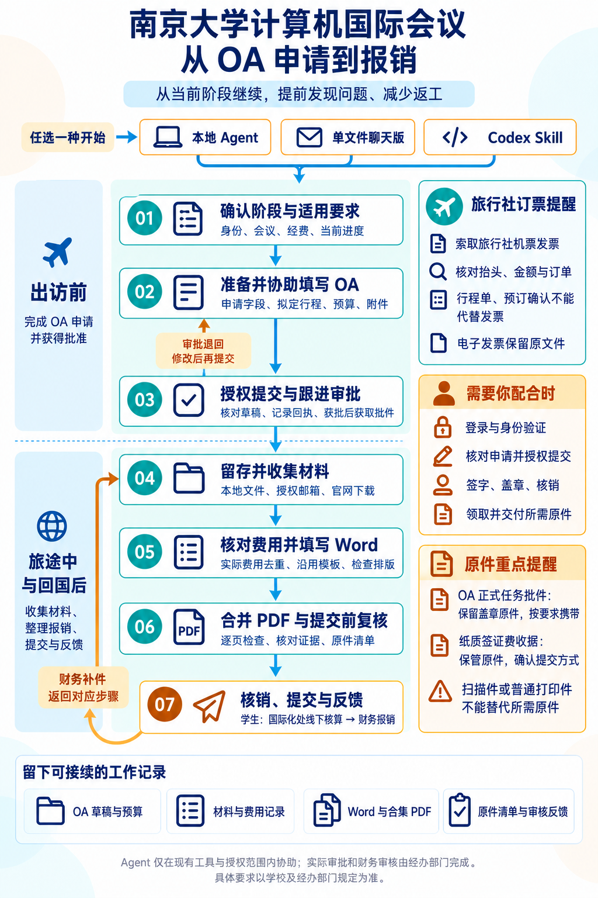

# 南京大学计算机国际会议报销工作流

帮助参会同学和 AI 助手从 OA 申请、材料收集走到汇总表填写与 PDF 复核。材料不齐也可以开始，按当前办理阶段继续推进。

## 开始使用

1. 下载 [START_CHAT.txt](START_CHAT.txt)，上传到你使用的 AI 助手，或粘贴完整内容。
2. 告诉它你的院系、学生身份、会议与行程、经费来源、当前阶段和已有材料；未知信息注明“不清楚”。
3. 发送：**“请按附件工作流，用中文协助我办理，从当前阶段开始，先检查已有材料，再推进缺少的事项。”**

能访问本地文件的 Agent 也可直接读取 [SKILL.md](skills/reimbursement-workflow/SKILL.md)。想先试用，可使用[虚构示例](examples/synthetic/README.md)。

## 核心文档

- [报销规则](skills/reimbursement-workflow/references/rules.md)：适用范围、政策依据和场景补充。
- [工作流程](skills/reimbursement-workflow/references/workflow.md)：材料准备、检查与交付标准。
- [财务复核](skills/reimbursement-workflow/references/finance-review.md)：逐条核验实际 PDF，记录问题并复查。

OA 可协助填写和上传，由申请人本人提交；签字、盖章、原件交付和财务审核仍由本人或相关老师办理。全部适用规则通过后才形成最终 PDF，通过检查不等于财务审批通过。

## 一起完善

欢迎[提 Issue](https://github.com/Weining-Cao/reimbursement-workflow/issues/new/choose)描述场景、问题和已有依据，也欢迎提交 PR 改进规则、文档或工具。详见[贡献指南](CONTRIBUTING.md)；新增场景可使用[规则模板](skills/reimbursement-workflow/references/scenarios/SCENARIO_TEMPLATE.md)，没有依据的要求保留为待确认。

真实材料保存在仓库外的私人目录，Issue、PR 和示例请脱敏。本项目是辅助整理工具，具体要求以学校现行规定及经办部门意见为准。

[MIT License](LICENSE)
