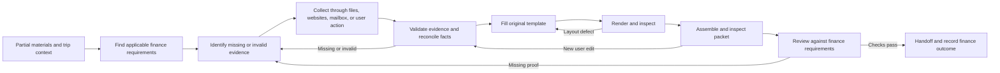

# Nanjing University International Computer Science Conference Reimbursement Workflow

An agent-assisted reimbursement workflow for **Nanjing University travelers attending international conferences in computer science**. It helps collect missing materials and prepare a packet for the university's reimbursement review. The agent finds the applicable rules, helps navigate websites and approval processes, retrieves invoices from authorized mailboxes, checks evidence, and repairs defects before handoff.

The success criterion is **acceptance without avoidable rework**, not simply creating a PDF. A pre-submission review must support that goal; only the institution's actual response establishes acceptance. All examples are fictional. Real claims, identity documents, and mailbox credentials are not included.

This is an independently maintained preparation aid, not an official university policy or approval. Apply current Nanjing University requirements and the receiving office's instructions for the traveler's role, funding source, and trip. Other institutions require a separate applicability review.

## Start here

Clone this repository or download and extract its ZIP, then open this README. Choose one route below. You can start with only your university unit, traveler role, and a brief conference/trip description; unknown details and missing documents are part of the work. You do not need Python, a mailbox connection, or a complete checklist to start.

### A. An agent that can read local files

Create a separate private case folder for your own materials and open that folder in your agent. Keep the extracted workflow package separate. Paste this, replacing the two paths with their full locations:

```text
Read [full path to extracted package]/skills/reimbursement-workflow/SKILL.md
and follow its linked workflow. My private case folder is [full case path].
Help me prepare Nanjing University reimbursement for an international computer
science conference. My unit, traveler role, and trip are: [what I know]. Inspect the available files and start with the gaps you can
resolve now. Ask only for facts or actions that you still need from me.
```

If the host cannot read a path, give it access through its normal file controls or use route B. No Skill installation is required for this route. For more context fields, use [the starter prompt](prompts/start.md).

### B. A chat that accepts text or attachments

Attach [START_CHAT.txt](START_CHAT.txt) from this repository, or paste its full contents if text-file upload is unavailable. Then say: "Follow the attached workflow. Help me prepare Nanjing University reimbursement for an international computer science conference. My unit, traveler role, and trip are: [what I know]. Here is what I have so far." Add whatever case materials you can provide. This one file contains the workflow, references, and working templates; you do not have to find each linked file yourself.

`START_CHAT.txt` is included and generated from the canonical sources, not maintained separately. To regenerate after editing the workflow, run `python3 scripts/export_chat_bundle.py START_CHAT-new.txt` and review the new export before replacing the committed copy. Python is needed only to regenerate it, not to read or use it.

### C. Install the Codex Skill for repeated use

Copy the **whole** `skills/reimbursement-workflow` folder into your private case folder's `.agents/skills/` directory. Do not copy only `SKILL.md`, nest an extra folder, or overwrite an existing installation. The final layout must be:

```text
my-private-case/
  .agents/skills/reimbursement-workflow/
    SKILL.md
    agents/
    assets/
    references/
    scripts/
```

Open `my-private-case` in Codex and send: `Use $reimbursement-workflow for the reimbursement materials in this folder. This is Nanjing University travel to an international computer science conference. My unit, traveler role, and trip are: ...`. If the skill is not detected, check the layout and restart Codex. You can also use route A with the installed `SKILL.md` path. Local discovery and invocation are described in the [official skills documentation](https://learn.chatgpt.com/docs/build-skills). This is a standalone skill folder, not a published plugin.

### What should happen first

The agent should read what you already have, identify the applicable process or the smallest missing context, and start a case record with concrete next actions. It should explain which collection or document steps it can perform in this host. It should not ask you to complete every template or obtain every file before beginning. If you have no files yet, it can still establish the process and collection plan.

| Missing capability | How to keep going |
| --- | --- |
| Web access | Use supplied official guidance; keep current-rule verification pending and request the specific official page or export needed |
| Mail connection | Continue local-file review; guide an available authorized connection or accept exported relevant messages/invoices |
| Word/PDF editing or rendering | Continue evidence review and field mapping; identify the missing conversion/inspection step before promising document outputs |
| Local file access | Keep case/ledger drafts in the chat or downloadable artifacts when supported; never claim to have saved files on the user's computer |

The workflow is maintained once, inside the self-contained skill bundle. The generic prompt and Codex adapter use that same file. This is an agent instruction package, not a standalone application with accounts already connected. Browser control, mailbox retrieval, document editing/rendering, OCR, and PDF merging use capabilities available in the host. The agent discovers them, reuses authorized connections, and identifies any missing capability. This repository does not bundle provider authentication or document engines.

## How it moves the case forward

1. Establish the applicable institution, traveler category, funding route, and actual acceptance requirements.
2. Build a requirement-to-evidence map. For each gap, act: search available files/mail, visit the right portal, download an existing document, or guide a specific user-only step.
3. Validate each acquired item before closing the gap. A receipt is not automatically an invoice; a downloaded approval is not automatically stamped.
4. Reconcile the expenses, fill the original form, render it, and assemble the current packet.
5. Review the final PDF as the receiving officer would. Repair missing proof, contradictions, calculations, signatures, and unreadable pages; repeat affected checks.
6. Hand off only when mandatory checks pass. Record the real finance outcome and turn any avoidable rejection into a regression scenario.

See [collection actions](skills/reimbursement-workflow/references/collection.md), [finance review](skills/reimbursement-workflow/references/finance-review.md), and a [fictional end-to-end walkthrough](examples/synthetic/collection-walkthrough.md).

An office visit can resolve only part of a case. The case record retains each question, response, condition, and affected expense so the agent can resume from the actual result, update authorized working copies, and recheck affected outputs without treating a completed visit as final acceptance.

## What the agent produces

| Artifact | Purpose |
| --- | --- |
| Requirement matrix and collection queue | Connect each requirement to acceptable evidence, a retrieval route, and a verified result |
| Case record and expense ledger | Record evidence, user decisions, blanks, and unresolved differences |
| Filled original Word form | Preserve the institution's structure and the user's confirmed content |
| Rendered summary PDF | Inspect actual line breaks, alignment, page boundaries, and signature space |
| Combined PDF and page manifest | Include the current summary and required evidence in explicit order |
| Finance review report | Map required checks to final packet pages; identify blockers and permitted separate paper materials |



## Try the fictional case

For a trial without personal files, follow the ready-to-paste prompt in [the examples](examples/synthetic/README.md). It starts a text-only review with clear expected results. The separate collection walkthrough illustrates website/mail steps; it does not execute them.

An optional Python 3.10+ utility records file hashes and detects changes after a reviewed build. It does **not** render documents, inspect PDF contents, validate expenses, or certify readiness.

These optional developer checks are not the reimbursement start command. Run them from the extracted `reimbursement-workflow` directory containing this README, not from your case folder. Use `python` instead of `python3` if that is your Python 3.10+ executable.

```sh
python3 skills/reimbursement-workflow/scripts/check_packet.py record \
  examples/synthetic/manifest.json --lock reimbursement-demo-1.lock.json
python3 skills/reimbursement-workflow/scripts/check_packet.py check \
  examples/synthetic/manifest.json --lock reimbursement-demo-1.lock.json
python3 -m unittest discover -s tests -v
```

Expected results: `Snapshot recorded`, then `UNCHANGED`, then passing utility tests. A second `record` with the same lock fails by design; run `check` to recheck it or choose a new lock name for a new reviewed revision. This is file freshness only, not a completed claim. See [the tool contract](skills/reimbursement-workflow/references/integrity.md) before applying it to a real case.

## Adapt and contribute

Start with [case.md](skills/reimbursement-workflow/assets/case.md), [expenses.csv](skills/reimbursement-workflow/assets/expenses.csv), and [review.md](skills/reimbursement-workflow/assets/review.md). Record institution-specific requirements with their source and applicability; never promote one traveler's exception to a universal rule.

Keep real cases in a separate private directory. Ignore patterns are only a convenience: inspect staged files and Git history before publishing. Do not include real evidence, identifiers, account details, correspondence, or document metadata in issues or examples. Reproduce failures with synthetic fixtures.

Changes to instructions should be checked against [behavioral scenarios](evals/scenarios.md). Automated tests cover the integrity utility and chat-export packaging; behavioral and document rendering scenarios require an agent run and artifact review. No claim is made that these manual scenarios have all been executed.

The share-package entry routes were exercised in a fresh extraction with synthetic files; see [the first-use check and its limits](evals/first-use.md).

For an authorized rehearsal on a private case, use [the non-destructive replay procedure](skills/reimbursement-workflow/references/replay.md). Keep all case files and execution records outside this repository.

Licensed under [MIT](LICENSE).
